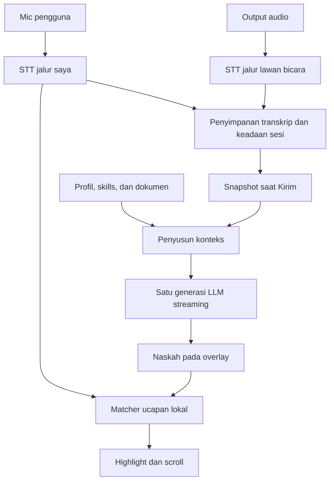

# Arsitektur Aplikasi Pendamping Percakapan Windows
Versi rancangan 0.3 • 24 Oktober 2026 • Bahasa utama: Indonesia dan Inggris

Status: rancangan teknis dan keputusan awal berdasarkan dokumentasi primer serta repositori yang diperiksa. Belum ada implementasi aplikasi atau benchmark Windows yang dijalankan. Angka konfigurasi dan target performa di bawah adalah usulan untuk diuji, bukan hasil pengukuran.

Revisi 0.3 menambahkan paket eksekusi untuk Claude Code/Codex, checkpoint lintas sesi, worktree paralel, serta gate pengujian yang membedakan replay, native Windows, audio fisik, dan provider nyata. Rancangan produk tetap berlaku; paket ini belum merupakan implementasi aplikasi.

## 1. Keputusan produk

Bentuk produk: aplikasi desktop Windows dengan dashboard persiapan sesi dan overlay teleprompter. Dua sumber audio tetap terpisah: lawan bicara dari output/loopback dan pengguna dari microphone. Transkripsi berjalan terus selama sesi aktif. Jawaban dibuat ketika pengguna menekan Kirim atau hotkey. Ucapan pengguna menggerakkan teleprompter melalui pencocokan teks lokal, tanpa panggilan LLM per gerakan scroll.

Mode utama:
- Transcribe only: transkripsi tanpa generasi jawaban.
- Send on demand: transkripsi terus berjalan; Kirim, Lanjutkan, dan Perbarui memanggil model sesuai tindakan pengguna.
- Auto assist, opsional: pembuatan/perubahan saran otomatis dengan kebijakan dan biaya tersendiri.

Mode Send on demand menjadi default. Hening, kalimat baru, dan interupsi tidak memanggil LLM secara otomatis pada mode ini. Penyiapan materi dan pembelajaran setelah sesi mempunyai pengaturan biaya terpisah.

Jawaban default berupa naskah pendek yang siap diucapkan, karena pengguna memperkirakan sekitar 90% ucapannya mengikuti saran. Contoh panjang awal: 80–140 kata; ini parameter UX yang bisa diubah. Mode poin singkat dan jawaban panjang tetap tersedia.

## 2. Arsitektur yang dipilih

| Bagian | Pilihan awal | Alasan |
|---|---|---|
| Shell desktop | Tauri 2 | Integrasi Windows dengan UI web; ukuran distribusi dan penggunaan sumber daya harus diukur pada build nyata. |
| UI | React + TypeScript + Vite | Memudahkan dashboard, overlay, dan model keadaan antarmuka. Tidak memerlukan server Next.js saat aplikasi digunakan. |
| Native core | Rust + async runtime | Menangani audio, koneksi STT, snapshot sesi, database, dan streaming model. |
| Audio | WASAPI melalui binding wasapi-rs/windows-rs | Capture mic dan loopback Windows; wasapi-rs merupakan kandidat MIT yang perlu diuji pada versi terpilih. |
| STT utama | Adapter Soniox | Kandidat pertama untuk diuji pada Indonesia–Inggris; bukan klaim pemenang benchmark. |
| STT pembanding | Adapter Deepgram Nova-3 | Pembanding dengan rekaman dan kondisi jaringan yang sama. |
| LLM | Adapter provider dengan keluaran streaming | Model dipilih pada profil sesi; protokol provider dinormalisasi. |
| Penyimpanan | SQLite + FTS5 | Sesi, transkrip, memori, dokumen, dan pencarian lokal. |
| Semantic search | Embedding multilingual + sqlite-vec, opsional | Ditambahkan bila pencarian lintas bahasa/parafrasa memerlukannya. |
| PDF | PDF.js pada worker persiapan | Ekstraksi dan pemetaan halaman; hasil tabel dan urutan baca tetap diperiksa. |
| Format Office | MarkItDown melalui worker terpisah saat import | Menambah dukungan DOCX/PPTX tanpa mempertahankan proses Python saat sesi berlangsung. |
| Scroll | Matcher kata lokal + pengendali scroll | Reuse transkrip mic; tidak membutuhkan model decision. |
| Memori | Catatan terstruktur dan playbook Markdown berversi | Mudah diperiksa, dapat dibatasi per ruang kerja dan sesi. |
| Distribusi | Installer + updater bertanda tangan | Instalasi pembaruan di luar sesi aktif; validasi versi dan kompatibilitas migrasi. |

Runtime minimal selama live: native core Tauri beserta proses WebView2 yang diperlukannya. Worker parsing/OCR tidak perlu terus hidup. Tidak dibutuhkan Docker, Redis, server vector terpisah, maupun gateway agent besar untuk penggunaan satu laptop.

Sumber pilihan teknis: [S01], [S02], [S03], [S04], [S05], [S10], [S11], [S12], [S13], [S14], [S15].

## 3. Peta aliran utama



Panah menunjukkan aliran data, bukan keputusan flowchart. STT dan generasi dapat berjalan bersamaan. Audio lawan bicara tidak digunakan untuk memajukan cursor naskah.

Jalur pemeliharaan berbeda: import dokumen, indeks, ringkasan, konsolidasi memori, evaluasi playbook, dan update aplikasi. Pekerjaan ini berprioritas rendah dan tidak boleh menahan jalur Kirim.

## 4. Reuse dan gabungan repositori

| Sumber | Ambil konsep/komponen | Batas penggunaan |
|---|---|---|
| Tauri | Shell, IPC, jendela, hotkey, updater | Audit versi dependency dan capability yang digunakan. |
| wasapi-rs | Binding capture audio | Uji dua endpoint, silent loopback, hot-plug, dan timestamp. |
| Meetily Community | Referensi capture audio dan pengalaman aplikasi meeting | Jangan mengasumsikan audio tetap dua jalur; README menyebut mixing, dan ada issue permintaan selective input/output. |
| TalkPrompter | Perilaku voice-follow, berhenti saat off-script, rejoin, UX Windows | MIT; implementasi .NET tidak langsung dimasukkan sebagai runtime tambahan ke aplikasi Tauri. Port konsep/algoritma yang relevan setelah pemeriksaan kode. |
| SpeechPrompter | Referensi sliding-window Levenshtein dan pemisahan interim/final | README menyatakan MIT; pemeriksaan berkas lisensi, kode, dan kematangan masih diperlukan sebelum mengambil kode. |
| Hermes Agent | Memori terkurasi, profil pengguna, skill procedural, session recall | Gunakan pola tersebut. Runtime Hermes utuh tidak wajib berada di jalur jawaban langsung. |
| OpenClaw | Penyimpanan durable, pemisahan memori dan konteks, flush sebelum compaction | Referensi arsitektur; lisensi setiap kode yang akan dipakai diperiksa tersendiri. |
| Enterprise Sales Copilot | Pemisahan conversation manager, konteks, generasi, provider | Apache-2.0; deteksi pertanyaan dengan LLM tidak diperlukan pada mode tombol Kirim. |
| PDF.js / MarkItDown | Ekstraksi materi | Hasil ekstraksi bukan bukti otomatis bahwa tabel dan diagram sudah terbaca benar. |
| SQLite FTS5 / sqlite-vec | Pencarian lokal | sqlite-vec masih pre-v1 pada dokumentasi yang diperiksa; pin versi dan sediakan jalur migrasi. |

Meetily bukan pilihan fork final sebelum spike dua jalur audio lolos. Proyek teleprompter kecil menjadi referensi, bukan bukti performa produksi. Produk berbayar seperti Cluely/Final Round dapat menjadi acuan pola interaksi, tanpa menyalin aset atau implementasi proprieternya.

Referensi: [S02], [S06], [S07], [S08], [S09], [S10], [S11], [S12], [S13], [S16], [S17], [S18].

## 5. Audio capture dan transkripsi

### 5.1 Routing

Setiap session menyimpan source_id, device_id, role, enabled, format, dan pilihan bahasa. Role awal adalah self dan remote. Keduanya bukan hasil verifikasi identitas biometrik. Beberapa peserta meeting berada pada jalur remote yang sama.

Input boleh diarahkan ulang melalui pemilih perangkat. Untuk dua mic atau virtual device, pengguna memetakan role secara eksplisit. System loopback menangkap output pada endpoint yang dipilih; audio per aplikasi menggunakan process loopback pada Windows yang mendukungnya. Proses browser dapat mencakup beberapa tab, sehingga pemilihan proses tidak identik dengan pemilihan tab.

Saat dua jalur berbunyi bersamaan, kedua indikator aktif dan kedua transkrip dipertahankan. Jangan memaksa salah satu menjadi satu-satunya speaker aktif.

### 5.2 Pipeline

Capture callback hanya menaruh frame pada bounded ring buffer. Resampling, encoding, network, database, dan UI berlangsung di luar callback. Gunakan satu clock monotonic lokal untuk pemetaan waktu sesi. Timestamp provider dipetakan kembali ke sesi, termasuk offset setelah reconnect.

Format audio dinormalisasi sesuai provider. Jika memakai PCM16 mono 16 kHz, dua jalur menggunakan sekitar 64 kB/detik payload audio atau 512 kbps sebelum overhead. Buffer 30 detik untuk keduanya sekitar 1,92 MB payload. Ini contoh hitungan format, bukan keharusan mengirim format tersebut ke semua provider.

Jangan memotong semua silence hanya untuk menghemat: endpointing, timestamp, dan protokol keepalive harus tetap benar. Penghematan melalui VAD harus mengikuti kontrak provider dan diuji agar awal/akhir kata tidak terpotong.

### 5.3 Transkrip

Normalisasi per provider menjadi event upsert:
- session_id, source_id, provider_connection_id;
- segment_id, revision;
- start_ms, end_ms;
- text, status partial/final;
- words opsional, language opsional;
- confidence opsional, bukan angka buatan jika provider tidak menyediakannya.

Partial mengganti partial sebelumnya dengan identitas yang sama. Final disimpan tanpa menduplikasi teks. Segmen mic dan remote diurutkan dengan rentang waktu; overlap tetap terlihat.

Status final ASR hanya berarti hasil sudah dikonfirmasi oleh sistem STT, bukan jaminan isi bebas salah dengar. Koreksi pengguna disimpan sebagai revisi dengan asal yang jelas.

Provider awal diuji dengan language hints Indonesia dan Inggris serta daftar nama/istilah domain jika tersedia. Jangan memasukkan seluruh naskah saran sebagai bukti transkripsi; bias naskah dapat membuat matcher tampak benar walau pengguna tidak mengucapkannya.

## 6. Semantik tombol Kirim

Kirim membuat snapshot konteks pada waktu klik. STT tidak berhenti selama request berlangsung.

Pemilihan target default: blok remote terbaru sejak jawaban sebelumnya, beserta ucapan self yang relevan. Pengguna dapat memilih rentang transkrip, mengetik pertanyaan sendiri, atau menambahkan instruksi. Jangan mengirim hanya satu kalimat terakhir jika pertanyaannya terdiri atas beberapa kalimat.

Jika audio sudah tertangkap tetapi STT belum mengejarnya:
1. Cek watermark audio yang sudah ditranskrip.
2. Bila hanya tertinggal sedikit, minta finalisasi jika provider mendukung dan tunggu dalam batas yang dikonfigurasi.
3. Jika tetap tertinggal, tampilkan status tertinggal; pengguna dapat mengirim bagian yang ada atau menunggu.
4. Jangan diam-diam menganggap bagian yang belum tertranskrip sebagai hening.

Jika tersedia partial yang cukup stabil, snapshot dapat menyertakannya dengan label provisional sesuai kebijakan sesi. Hasilnya tidak boleh diam-diam diganti setelah request berjalan. Koreksi berikutnya masuk pada Perbarui.

Contoh kontrak request:

```json
{
  "request_id": "req-018",
  "session_id": "session-01",
  "action": "answer",
  "snapshot_revision": 412,
  "target_segment_ids": ["remote-087", "remote-088"],
  "context_packet_id": "ctx-018",
  "model_profile_id": "fast-id",
  "output_language": "id",
  "answer_style": "spoken",
  "provisional_segments": []
}
```

Action: answer, shorten, expand, continue_unread, revise_unread. Model dipanggil setelah tindakan ini. Klik ganda identik dideduplikasi. Request baru mempunyai generation_id berbeda. Hasil request yang dibatalkan atau sudah superseded tidak boleh menimpa layar.

Kirim tidak memerlukan LLM classifier sebelumnya: pengguna sudah menentukan kebutuhan jawaban. Jika kelak Auto assist diaktifkan, classifier menjadi opsi terpisah dan overheadnya diukur.

## 7. Orkestrasi: tiga mesin keadaan independen

Jangan memakai satu status global seperti LISTENING/ANSWERING karena mic, remote, generasi, dan pembacaan bisa berlangsung bersamaan.

| Mesin | Status |
|---|---|
| Capture/transcription | stopped, connecting, live, degraded, paused |
| Generation | idle, preparing_context, streaming, completed, cancelled, failed |
| Prompter | inactive, tracking, off_script, paused_manual, reacquiring |

Orchestrator awal adalah pengelola event dan aturan, bukan sekumpulan agent yang saling berdiskusi. Tugasnya membuat snapshot, mengatur prioritas, memilih konfigurasi model, menyusun konteks, membatalkan request, dan menjaga versi.

Normalnya satu request LLM generatif per Kirim. Tidak perlu urutan router LLM → planner LLM → retrieval LLM → writer LLM → critic LLM pada jalur normal. Jika pengguna meminta penalaran mendalam, mode tersebut boleh memakai waktu dan biaya lebih besar secara eksplisit.

Urutan prioritas: kontinuitas capture dan STT; kendali UI dan request pengguna; kemudian preprocessing serta pemeliharaan memori. Background job dibatasi konkurensinya agar tidak merebut resource jaringan/CPU.

## 8. LLM adapter dan streaming

Provider interface minimal:
- validate_configuration();
- capabilities(): model, input_limit, output_limit, context_limit, streaming, tools, cancellation;
- estimate_tokens(context);
- generate_stream(snapshot, context, parameters);
- cancel(request_id);
- normalize_usage().

Event UI: response_started, text_delta, response_completed, response_failed. Simpan model/provider yang benar-benar menjawab. Satu jawaban tidak menggabungkan potongan dari dua provider.

Gunakan teks/Markdown sederhana agar frasa pertama segera bisa dirender. Jangan menunggu satu objek JSON besar selesai hanya untuk menampilkan jawaban. Sumber dokumen bisa diberi ID yang disediakan context packet; UI memvalidasi ID tersebut. Parser lokal membentuk paragraf dan anchor naskah setelah prefix stabil.

Pergantian model saat idle langsung mengubah profil request berikutnya. Saat ada generasi aktif, pilihan default berlaku pada request berikutnya; tombol restart dapat membatalkan dan mengulang secara eksplisit. Context dianggaran ulang sesuai model baru, termasuk reserve output. Provider yang mengaku OpenAI-compatible belum tentu mendukung seluruh event, tools, cancellation, atau parameter yang sama.

Retry otomatis terbatas hanya untuk kegagalan sebelum ada keluaran yang dipakai. Setelah teks muncul, UI menandai jawaban terputus dan menawarkan lanjutkan/ulang. Timeout, fallback, serta konsumsi token dicatat.

Pilihan model konkret ditentukan melalui uji latency, akurasi pada materi, kemampuan Indonesia–Inggris, dan biaya. Streaming adalah syarat, tetapi first token cepat belum menjamin frasa pertama berguna cepat.

## 9. Dokumen dan kebutuhan retrieval

20 file × 30 halaman = sampai 600 halaman. Sebagai ilustrasi, jika rata-rata 400 token/halaman, isinya sekitar 240.000 token sebelum riwayat, instruksi, dan keluaran. Ini asumsi hitung, bukan estimasi pasti isi dokumen pengguna.

Karena itu, gunakan:
1. Brief sesi dan fakta yang dipin, selalu dimasukkan.
2. Dokumen pendek dan relevan dapat dimasukkan utuh jika masuk anggaran.
3. Dokumen lain dipanggil berdasarkan bagian yang relevan.
4. Dokumen asli tetap tersedia sebagai sumber, bukan digantikan ringkasan.

Mengambil bagian dokumen lalu memasukkannya ke generasi sudah termasuk pola retrieval-augmented generation. Yang tidak wajib adalah vector server atau framework RAG besar.

### 9.1 Import

Hash file → ekstraksi halaman/section → pemeriksaan kualitas → segmentasi → indeks → brief dan fakta yang disetujui. Ringkasan LLM saat persiapan bersifat opsional dan biayanya ditampilkan.

Simpan document_id, version/hash, original_name, page_start/end, section, text, extraction_quality. Jangan memberi nomor halaman palsu pada format yang tidak memiliki halaman stabil. Slide menggunakan nomor slide; DOCX bisa menggunakan section/paragraf.

PDF.js untuk PDF berbasis teks. MarkItDown sebagai pilihan konversi Office. Scan, diagram, dan tabel rumit memerlukan jalur OCR/layout tersendiri. Tandai halaman yang belum terbaca baik, karena pencarian tidak dapat mengambil fakta yang hilang saat ekstraksi.

### 9.2 Pencarian

Baseline: SQLite FTS5/BM25 atas teks bagian, judul, alias, dan glossary. Bentuk query lokal dari target percakapan dan kata kunci konteks; perlakukan teks pengguna sebagai data, bukan SQL atau syntax FTS bebas yang tak divalidasi.

Untuk Indonesia–Inggris dan parafrasa, siapkan adapter embedding multilingual. Kandidat lokal untuk spike adalah multilingual-e5-small; model card mencantumkan Indonesia, Inggris, dan MIT. Implementasi harus mengikuti batas panjang dan format input model yang dipilih. Opsi embedding cloud mengurangi beban inferensi lokal dengan konsekuensi biaya dan pengiriman teks.

Gabungkan ranking lexical dan semantic; deduplikasi bagian, perluas konteks tetangga, pertahankan tabel relevan, dan kemas berdasarkan budget token. Reranker terpisah ditambahkan hanya jika evaluasi retrieval membuktikan kebutuhan. Embedding dokumen dihitung saat import, bukan diulang setiap Kirim.

FTS saja dapat menjadi versi awal, tetapi kegagalan lintas bahasa harus diuji. Cache retrieval dari partial yang stabil boleh dipersiapkan di latar belakang; snapshot final tetap menentukan konteks yang dikirim.

## 10. Bentuk konteks dan memori

| Lapisan | Isi | Penggunaan |
|---|---|---|
| Profil pengguna | Fakta diri yang telah dikonfirmasi, cara bicara | Dipilih sebelum sesi; snapshot stabil |
| Workspace/project | Fakta, glossary, dokumen dan konteks proyek | Hanya dalam ruang kerja yang dipilih |
| Playbook/skills | Cara menyusun jawaban, aturan nada, contoh baik | Dipilih pada persiapan dan dimuat sesuai kebutuhan |
| Memori sesi | Pertanyaan, koreksi, keputusan, pembahasan aktif | Diperbarui selama percakapan sesuai kebijakan |
| Memori pengalaman | Ringkasan sesi terdahulu dan feedback | Diambil ketika relevan |
| Arsip | Transkrip, jawaban saran, revisi, sumber | Bukti asli yang bisa dicari kembali |

Hermes mendokumentasikan memori terkurasi, profil pengguna, snapshot saat awal sesi, serta recall sesi lama [S16]. Skills-nya berupa prosedur yang dimuat sesuai kebutuhan [S17]. OpenClaw mendokumentasikan penyimpanan memori durable dan pemeliharaan sebelum compaction [S18], [S19].

Adaptasi untuk aplikasi ini: profil dan skill stabil ditempatkan di prefix; fakta/koreksi sesi aktif ditambahkan sebagai blok baru dengan versi. Jangan hanya menunggu sesi berikutnya agar koreksi penting terlihat. Cache prefix adalah optimasi provider, bukan jaminan kecepatan.

Skill bukan tempat menyalin seluruh PDF. Contoh skill: jawaban interview dengan STAR, penjelasan teknis tiga bagian, atau gaya presentasi formal-santai. Dokumen menyimpan bukti; memori menyimpan hal yang perlu diingat; skill menyimpan cara bekerja.

### 10.1 Memori yang makin berguna

Model dasar tidak otomatis dilatih ulang dari riwayat. Yang meningkat adalah konteks, contoh jawaban yang telah divalidasi, preferensi, dan pemilihan playbook.

Setiap calon memori memuat: scope, kind, text, source_refs, status, created_at, supersedes, dan confidence jika ada dasar penilaiannya. Angka confidence adalah skor internal terkalibrasi jika digunakan, bukan bukti kebenaran.

Kebijakan:
- Koreksi eksplisit pengguna diterapkan segera pada sesi dan dapat disimpan sesuai pilihan pengguna.
- Preferensi berulang dan ringkasan sesi dapat menjadi draft.
- Fakta biodata, pengalaman kerja, prestasi, dan komitmen penting membutuhkan dasar/konfirmasi yang jelas.
- Saran model dan ucapan pihak lain tidak otomatis menjadi fakta pribadi pengguna.
- Pengguna membacakan saran model tidak menjadi verifikasi independen atas kebenaran saran tersebut.
- Konflik ditandai atau disupersede; jangan diam-diam menimpa fakta.
- Memori dapat diedit, dilupakan, diekspor, dan dikembalikan ke versi sebelumnya.

Untuk mode hemat, tidak ada panggilan LLM pemeliharaan otomatis selama live. Simpan log dan koreksi secara deterministik; konsolidasi dilakukan setelah sesi. Pengguna bisa menyalakan pembaruan ringkasan berkala dengan biaya terpisah.

### 10.2 Pembelajaran skill

Sesudah sesi: baca feedback dan sumber yang dipilih → usulkan perubahan playbook → uji pada contoh yang tetap → simpan versi kandidat → aktifkan jika hasil lebih baik dan perubahan sesuai pilihan pengguna.

Jangan otomatis menyimpan semua jawaban yang tidak dikoreksi sebagai jawaban benar. Jangan membiarkan sistem menulis ulang kode aplikasinya dari percakapan. Knowledge update, skill update, dan binary update merupakan tiga mekanisme yang berbeda.

## 11. Context budget dan auto-compaction

250k berarti ceiling token yang diminta pengguna, bukan kewajiban memuat 250k pada setiap request. Gunakan batas input/output/context resmi dari model aktif.

Budget efektif memperhitungkan:
- batas konteks dan batas input provider;
- reserve output;
- system/skills/tools bila digunakan;
- margin ketidakpastian hitungan token.

Contoh konfigurasi awal untuk diuji: active context target 24k–32k token, lalu disesuaikan dengan kompleksitas materi. Ini pilihan rancangan, bukan hasil benchmark. Fakta yang dipin dan sumber yang diperlukan lebih penting daripada mempertahankan semua percakapan mentah di prompt.

Sebelum compaction: persist fakta dan koreksi durable, pertahankan pertanyaan aktif, angka/nama, keputusan, ketidakpastian, dan references ke segmen asli. Buat summary terstruktur per rentang waktu. Jangan berulang kali meringkas hanya ringkasan lama sambil kehilangan sumber asli.

Raw transcript tidak dihapus oleh compaction. Background summary memakai revision/coverage range supaya tidak menimpa koreksi baru. Jika pengguna beralih ke model dengan konteks lebih kecil, kemas ulang context packet dari sumber yang sama; jangan memotong pesan secara acak.

## 12. Auto-scroll yang mengikuti ucapan

Karena 90% ucapan diperkirakan mengikuti naskah, pencocokan urutan kata menjadi jalur utama. Semantic reasoning per kalimat tidak diperlukan untuk menggerakkan scroll normal.

Pipeline:
1. Bentuk spoken_text dari naskah; keluarkan label sumber, syntax Markdown, dan elemen UI dari teks yang dicocokkan.
2. Simpan pemetaan token → paragraf → offset tampilan.
3. Normalisasi kapital, tanda baca, angka Indonesia/Inggris, singkatan dan filler yang relevan.
4. Cocokkan potongan transkrip self dengan jendela sekitar cursor menggunakan word-level edit distance/sequence alignment.
5. Beri penalti untuk lompatan besar; jangan mencari seluruh naskah hanya dari satu kata umum.
6. Pisahkan tentative cursor dari committed cursor. Partial dapat menggerakkan highlight sementara; final/kestabilan beberapa update memperkuat posisi.
7. Scroll menuju reading band, bukan ke bawah otomatis dengan timer.

Contoh parameter spike: jendela 10 kata ke belakang dan 80 kata ke depan; anchor 3–5 kata yang cukup khas; konfirmasi posisi pada beberapa update. Semua angka perlu dituning pada korpus pengguna. Jangan menyalin threshold dari repo sebagai angka universal.

Jika pengguna mengulang kalimat: izinkan mundur terbatas dengan bukti frasa yang cukup. Jika melewati satu bagian: rejoin pada anchor yang jelas. Jika berbicara bebas: freeze/off_script, lalu reacquire ketika frasa cocok kembali. Manual klik kata mengatur cursor. Manual scroll menahan follow sampai diaktifkan kembali.

Silence tidak selalu berarti layar harus membeku seketika: update ASR terakhir boleh menyelesaikan penempatan kata yang sudah terucap, kemudian viewport berhenti. Interupsi remote tidak memajukan cursor. Tidak ada LLM yang dipanggil untuk fungsi ini.

Naskah yang masih streaming hanya ditambahkan ke bagian akhir. Paragraf yang sedang dibaca dibekukan. Pada Perbarui/Lanjutkan, snapshot berisi ucapan aktual, cursor, ketidakpastian posisi, dan pertanyaan baru. Model diarahkan memperbarui bagian belum dibaca. Hasilnya menjadi versi baru; suffix tidak disambung otomatis jika struktur atau maksud jawabannya sudah berubah.

Referensi algoritma/perilaku: [S08], [S09]. Dukungan bahasa yang dicantumkan repositori belum membuktikan kualitas code-switching atau akurasi pada suara pengguna.

## 13. UI dan interaksi

Dashboard persiapan:
- Sesi, Materi, Profil, Playbook, Model, Audio, Riwayat.
- Satu halaman kesiapan menunjukkan label kedua sumber, meter suara, status indeks, dokumen aktif, bahasa, dan profil biaya.
- Tombol utama Mulai sesi; tidak perlu menavigasi settings saat live.

Overlay:
- Mode ringkas: dua meter suara, status transkripsi, tombol Kirim.
- Mode membaca: pertanyaan singkat, naskah, reading band, sumber yang dapat dibuka.
- Drawer opsional: transkrip dan instruksi tambahan.
- Aksi utama: Kirim, Perbarui, Lanjutkan, Lebih singkat, Pause, Follow.
- Status transkripsi dan status generasi ditampilkan terpisah.
- Bahasa jawaban dapat mengikuti lawan bicara atau dikunci ke Indonesia/Inggris.
- Jendela tidak merebut fokus ketika respons masuk.
- Hotkey dapat diubah dan diperiksa benturannya.
- Teks yang sedang dibaca tidak di-reflow karena perubahan font, sumber, atau animasi.
- Animasi meter sederhana; opsi reduced motion dan mode kontras tinggi.

Desain awal: latar netral gelap/terang, satu warna aksen, teks sekitar 20–26 px pada mode membaca, lebar jendela dapat diatur. Angka ukuran adalah usulan UI yang perlu dites pada skala Windows 100%, 125%, dan 150%.

Screen-share exclusion:
Gunakan mekanisme Windows yang didukung untuk jendela aplikasi sendiri, lalu uji kombinasi aplikasi meeting dan mode capture. SetWindowDisplayAffinity bukan jaminan universal [S20]. Label UI adalah status konfigurasi/pengujian, bukan janji tidak terdeteksi. Gunakan pendamping AI sesuai aturan sesi/interview yang berlaku.

## 14. Skema penyimpanan

| Entity | Kolom penting |
|---|---|
| workspaces | id, title, profile_id, policy_version |
| sessions | id, workspace_id, started_at, ended_at, active_revision, settings_snapshot |
| audio_sources | id, session_id, device_id, role, format, enabled |
| transcript_segments | id, session_id, source_id, start/end, revision, status, text, provenance |
| generation_requests | id, session_id, snapshot_id, model_profile, action, status |
| suggestions | id, request_id, version, content, source_refs, usage |
| reading_progress | session_id, suggestion_version, committed_index, tentative_index, confidence_state |
| documents | id, workspace_id, hash, original_name, extraction_status |
| document_sections | id, document_version, section, page/slide, text, token_count |
| memory_items | id, scope, kind, text, status, source_refs, supersedes |
| skill_versions | id, skill_name, version, content, feedback_refs, active |
| session_summaries | id, coverage_range, input_revision, content, source_refs |
| jobs | id, kind, priority, status, input_revision, retry_count |

Gunakan satu jalur penulisan yang terkontrol dan transaksi singkat. Proses audio tidak menunggu lock database. Scope workspace/session wajib diterapkan di query agar sesi interview tidak mengambil materi proyek lain tanpa pilihan pengguna.

## 15. Failure handling dan batas kepercayaan

- STT putus: indikator degraded, reconnect, tandai rentang gap; jangan menciptakan transkrip pengganti.
- Perangkat hilang: tawarkan pilihan baru; jangan diam-diam beralih mic dengan role yang salah.
- Provider LLM gagal: pertahankan naskah lama, tandai kegagalan, beri retry.
- Dokumen gagal diekstrak: tampilkan halaman/section bermasalah.
- Retrieval tidak menemukan dasar: sarankan keterbatasan atau klarifikasi, bukan mengarang sumber.
- Compaction gagal: pertahankan riwayat, gunakan context packet terakhir yang valid atau pengecilan berbasis sumber.
- Pembaruan skill/memori gagal validasi: simpan versi sebelumnya.
- Dokumen dan transkrip diperlakukan sebagai materi sumber, bukan izin menjalankan perintah aplikasi.
- API key berada pada penyimpanan kredensial OS/native core, bukan log atau state UI yang diekspor.
- Simpan audio mentah hanya jika dipilih; transkrip, dokumen, dan ringkasan memiliki pengaturan retensi dan hapus.
- Update binary dilakukan di luar sesi; backup/migrasi database dan rollback diperiksa.

## 16. Anggaran biaya

Pisahkan meter:
1. STT per jalur dan durasi sesuai kebijakan billing provider.
2. LLM request yang dipicu pengguna.
3. Embedding dan penyiapan dokumen.
4. Memory/skill consolidation opsional.

Rumus konseptual:
biaya = audio_tertagih × tarif_STT + token_input × tarif_input + token_output × tarif_output + embedding/preparation/maintenance.

Dua stream yang terbuka satu jam dapat menghasilkan dua jam-channel tertagih; jangan menganggap satu sesi satu jam berarti satu jam STT. Detail silence, connection minimum, dan multichannel diperiksa pada provider yang dipilih.

Tombol Kirim menekan biaya generasi jawaban; ia tidak menghapus biaya STT yang terus berjalan. Background LLM dimatikan pada profil hemat. Fitur belajar dapat dijalankan sekali setelah sesi atau ketika diminta.

## 17. Rencana validasi yang wajib sebelum keputusan final

Belum ada hasil uji pada dokumen ini.

Korpus awal: rekaman berizin dengan Indonesia, Inggris, code-switching, nama proyek, angka, singkatan, filler, jeda panjang, pertanyaan beberapa kalimat, dan overlap. Tambahkan kalimat sama yang muncul beberapa kali dalam naskah.

| Area | Ukuran |
|---|---|
| STT | Akurasi kata dan entitas/angka; keterlambatan partial/final; kesalahan label sumber |
| Audio | Kehilangan frame, drift, clipping, leakage mic/output, reconnect |
| Kirim | Klik sampai frasa pertama yang dapat dipakai; jawaban lengkap; persentil p50/p95 |
| Retrieval | Apakah bukti relevan ditemukan; kasus lintas bahasa; ketepatan halaman/sumber |
| Jawaban | Ketepatan fakta, relevansi, konsistensi biodata, tidak mengklaim pengalaman tak ada |
| Scroll | Salah lompat per menit, waktu reacquire, stabilitas saat interim berubah |
| Memori | Fakta salah yang dipromosikan, konflik, scope leakage, kualitas setelah koreksi |
| Resource | CPU/RAM seluruh proses termasuk WebView2, jaringan, daya selama meeting |
| Recovery | Cancel, double-click, model switch, provider timeout, app restart |
| UX | Beban membaca, fokus keyboard, skala Windows, mouse override, reduced motion |

Calon sasaran spike: pencocokan lokal selesai di bawah 50 ms per update pada perangkat target; Kirim sampai frasa berguna p50 di bawah 1,5 detik dan p95 di bawah 3 detik pada koneksi uji. Ini target desain yang dapat gagal, bukan janji atau benchmark yang sudah dicapai.

Uji 30–60 menit bersama Zoom/Meet/Teams pada perangkat pengguna. Screen-share exclusion diuji sebagai matriks versi Windows, versi aplikasi, share screen/window, mode capture, serta perekam. Jangan mengekstrapolasi hasil satu kombinasi ke semuanya.

## 18. Urutan implementasi

1. Spike audio + STT: dua jalur, timestamp, reconnect, evaluasi Indonesia/Inggris.
2. Spike voice-follow: transkrip mic yang sama → matcher → highlight/scroll, termasuk skip/repeat/off-script.
3. MVP jawaban: snapshot tombol Kirim, satu model streaming, naskah stabil, cancel/versions.
4. Materi sesi: import, pinned brief, full-document selection, FTS; semantic search bila diperlukan evaluasi.
5. Memori dan skills: profil, correction log, summary setelah sesi, playbook berversi.
6. Pengerasan produk: packaging, update, retensi, pengujian meeting, UX aksesibel.
7. Auto assist hanya setelah pola manual terbukti membantu dan biaya/false-trigger dapat diterima.

Keputusan fork/reuse final diambil setelah dua spike pertama. Jangan menggabungkan seluruh aplikasi desktop berbeda ke satu paket sebelum batas komponen, runtime, lisensi, dan format eventnya jelas.

## 19. Referensi primer

Diperiksa pada 24 Oktober 2026. Detail versi, lisensi komponen turunan, dan kontrak API perlu dipastikan lagi ketika implementasi dimulai.

[S01] Tauri architecture — https://v2.tauri.app/concept/architecture/
[S02] wasapi-rs — https://github.com/HEnquist/wasapi-rs
[S03] Microsoft WASAPI loopback — https://learn.microsoft.com/en-us/windows/win32/coreaudio/loopback-recording
[S04] Microsoft process loopback sample — https://learn.microsoft.com/en-us/samples/microsoft/windows-classic-samples/applicationloopbackaudio-sample/
[S05] Soniox streaming transcription — https://soniox.com/docs/stt/rt/real-time-transcription
[S06] Meetily Community — https://github.com/Zackriya-Solutions/meetily
[S07] Meetily selective source issue — https://github.com/Zackriya-Solutions/meetily/issues/337
[S08] TalkPrompter — https://github.com/Sven-Bo/talkprompter
[S09] SpeechPrompter — https://github.com/idsus/SpeechPrompter
[S10] SQLite FTS5 — https://sqlite.org/fts5.html
[S11] sqlite-vec — https://github.com/asg017/sqlite-vec
[S12] PDF.js — https://github.com/mozilla/pdf.js
[S13] Microsoft MarkItDown — https://github.com/microsoft/markitdown
[S14] Deepgram model/language overview — https://developers.deepgram.com/docs/models-languages-overview
[S15] Multilingual E5-small model card — https://huggingface.co/intfloat/multilingual-e5-small
[S16] Hermes memory — https://github.com/NousResearch/hermes-agent/blob/main/website/docs/user-guide/features/memory.md
[S17] Hermes skills — https://github.com/NousResearch/hermes-agent/blob/main/website/docs/user-guide/features/skills.md
[S18] OpenClaw memory — https://docs.openclaw.ai/concepts/memory
[S19] OpenClaw compaction — https://docs.openclaw.ai/concepts/compaction
[S20] Microsoft display affinity — https://learn.microsoft.com/en-us/windows/win32/api/winuser/nf-winuser-setwindowdisplayaffinity
[S21] Tauri updater — https://v2.tauri.app/plugin/updater/
[S22] Enterprise Sales Copilot source — https://github.com/SalesforceAIResearch/enterprise-sales-copilot
[S23] Enterprise Sales Copilot preprint — https://arxiv.org/html/2603.21416v1
[S24] Deepgram interim/final and endpointing — https://developers.deepgram.com/docs/understand-endpointing-interim-results/
[S25] Soniox supported languages — https://soniox.com/docs/stt/concepts/supported-languages


## 20. Pelaksanaan oleh Claude Code dan Codex

Dokumen ini menjadi docs/ARCHITECTURE.md di paket Windows_Conversation_Assistant_Agent_Pack. Mulai dari START_HERE.md dan prompts/START.md. AGENTS.md menjadi instruksi bersama; CLAUDE.md mengimpor file tersebut agar aturan tidak bercabang.

Target pelaksanaan adalah implementasi, build, pengujian, perbaikan, dan pembuatan installer oleh coding agent. Agent tidak cukup menghasilkan rencana atau UI demonstrasi. Pengguna hanya perlu menyediakan lingkungan/perangkat/kredensial yang memang tidak dimiliki agent.

### 20.1 Fase dan paralel
P00 fondasi/kontrak dan P01 vertical slice dijalankan berurutan. Sesudah baseline replay/kontrak diterima, pekerjaan audio/provider, UI/teleprompter, dan konteks/dokumen dapat berjalan paralel dengan maksimum tiga worker dan satu coordinator. Integrasi branch, kontrak, migrasi, dependensi, dan status global memiliki satu penanggung jawab.

Gunakan worktree terpisah yang mengacu baseline commit yang sama. Verifikasi ref aktual sebelum editing. Claude Code dan Codex dapat bergantian sebagai coordinator atau bekerja sebagai worker dengan batas file yang berbeda. Jika fitur paralel tidak tersedia, task graph tetap dilaksanakan berurutan.

Paket memuat 28 task yang dipetakan ke tujuh fase P00–P06. Status implementasi dan verifikasi dipisahkan: kode yang selesai belum otomatis membuktikan perilaku native Windows. Gate native yang tidak tersedia tidak menghalangi pekerjaan portable independen, tetapi tetap menghalangi klaim rilis terverifikasi.

### 20.2 Kontinuitas sesi
Simpan state, task, keputusan, baseline commit, evidence, handoff worker, dan tindakan berikutnya dalam repo. Agent baru membaca file aktual dan git state, bukan mengandalkan percakapan lama. Setelah context compaction atau berpindah alat, gunakan prompts/RESUME.md. Jangan mengulang fase selesai atau menghidupkan kembali worker yang sudah tidak ada.

### 20.3 Bukti pengujian
Verifikasi dibagi L0 unit/static, L1 replay integration, L2 browser UI, L3 aplikasi Tauri asli, L4 audio fisik, L5 provider sungguhan, dan L6 installer/capture compatibility. Test UI browser dengan bridge mock tidak membuktikan IPC/WASAPI atau fokus jendela Windows.

L3 menjalankan binary Tauri dengan Rust/storage/IPC asli; boundary provider boleh memakai server fixture lokal yang diberi label. L4 memerlukan endpoint Windows nyata; injeksi file atau event perubahan perangkat hanya replay/simulasi. L5 memakai key dan budget yang tersedia. Semua level mencatat boundary yang diganti.

Laporan berisi revisi kode, lingkungan, perintah, exit code, jumlah kasus, hasil, dan lokasi bukti. Status yang sah: pass, fail, blocked, not_run, waived. Tes kosong atau semua skip bukan pass. Fitur fixture/automation hanya ada pada build test dan diverifikasi tidak aktif pada release.

### 20.4 Batas otomasi yang nyata
Coding agent dapat mengerjakan seluruh siklus lokal yang didukung alatnya. Agent di Linux/cloud dapat menyiapkan dan menguji modul portable; aplikasi Windows/audio fisik memerlukan jalur eksekusi Windows. Tidak adanya key membatasi live smoke saja. Sesi desktop interaktif, perangkat, certificate signing, atau aplikasi meeting tertentu tidak boleh dianggap tersedia tanpa pemeriksaan.

Agent melanjutkan pekerjaan independen, mencatat gap sekali, dan menyiapkan perintah verifikasi yang dapat dijalankan. Agent tidak boleh mengklaim semua E2E lulus jika hanya fixture/browser yang dijalankan. Publikasi, pembelian layanan, dan perubahan keamanan sistem tidak termasuk kebutuhan implementasi lokal.

### 20.5 Isi paket pendamping
- docs/EXECUTION.md: ownership, worktree, merge barrier, checkpoint, recovery.
- docs/IMPLEMENTATION_PLAN.md: urutan fase dan syarat kelulusan.
- docs/TESTING.md: command contract, skenario, CI, native/audio/live/installer, bukti.
- docs/CONTRACTS.md dan .agent/schemas/: event/snapshot/report/state.
- .agent/tasks.json, acceptance.json dan tests/scenarios.json: 28 task, 22 kebutuhan penerimaan, 32 spesifikasi skenario.
- roles/ dan .claude/agents/: peran portable dan wrapper opsional.
- prompts/: prompt mulai, lanjut, delegasi dan review.
- tools/check_pack.py: validasi paket instruksi, terpisah dari tes aplikasi.

Referensi workflow resmi tersedia di docs/SOURCES_WORKFLOW.md dalam paket. Keberhasilan paket diperiksa tidak berarti implementasi, native E2E, atau provider live sudah lulus.

